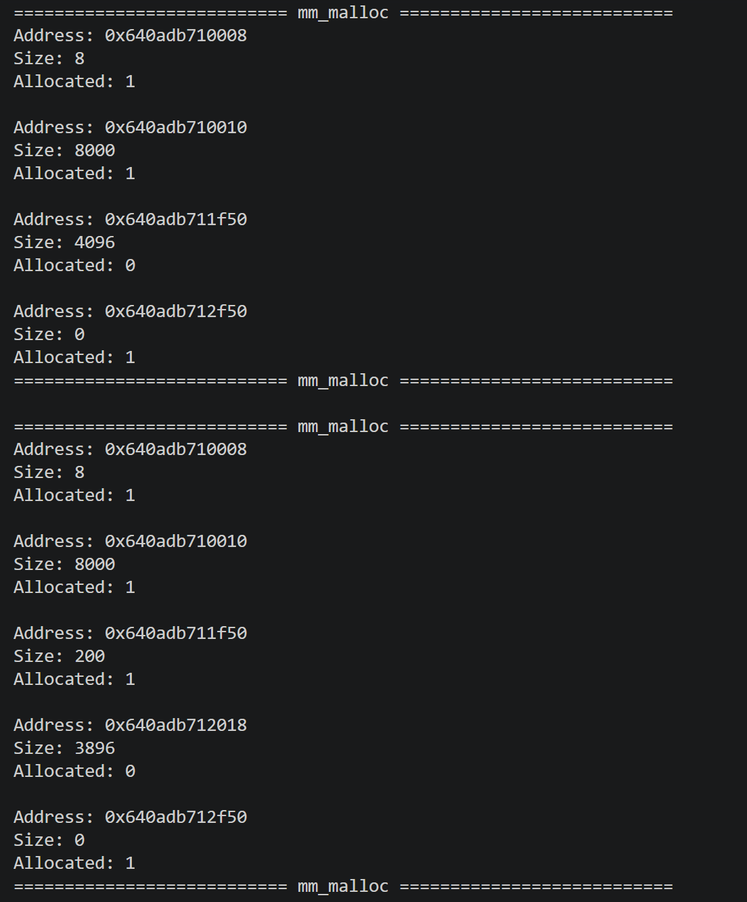
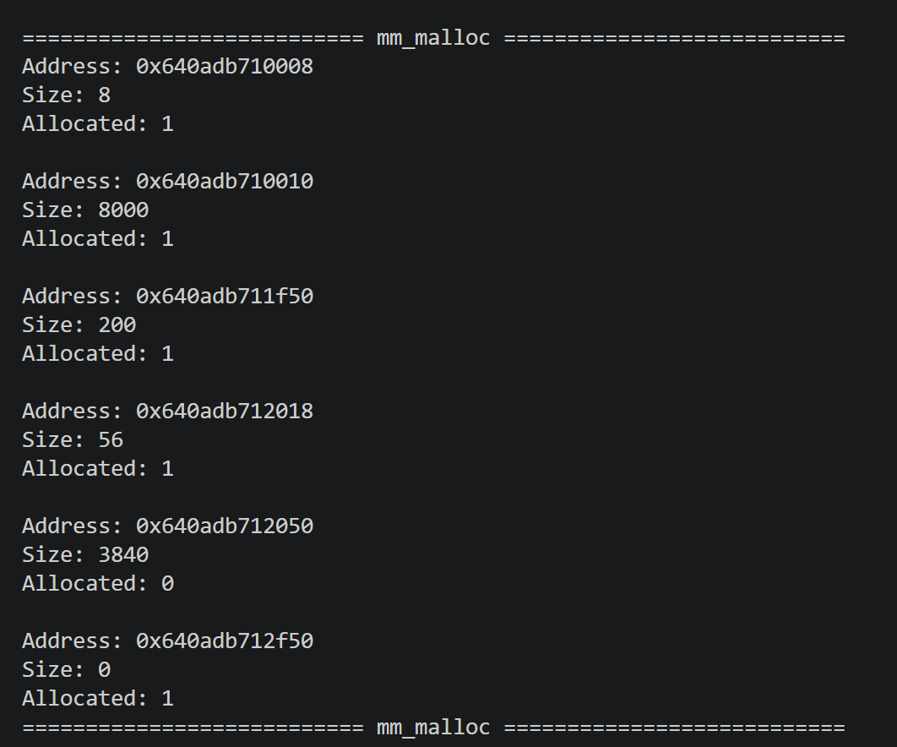
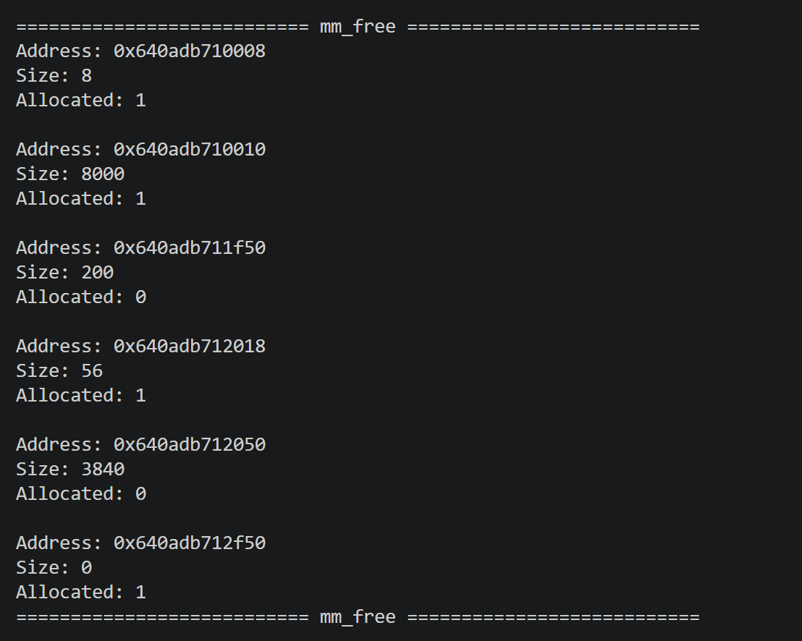
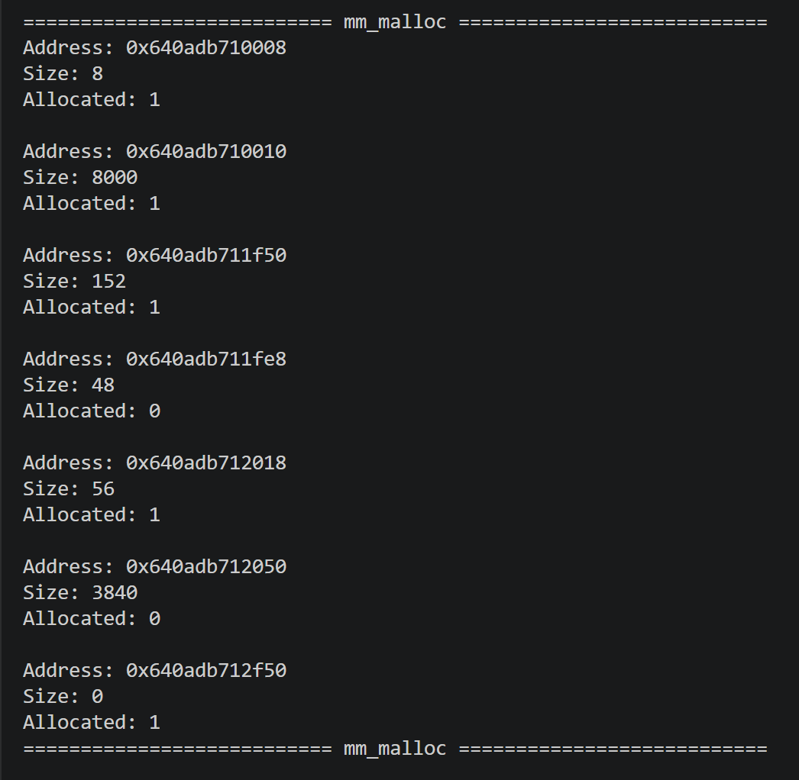
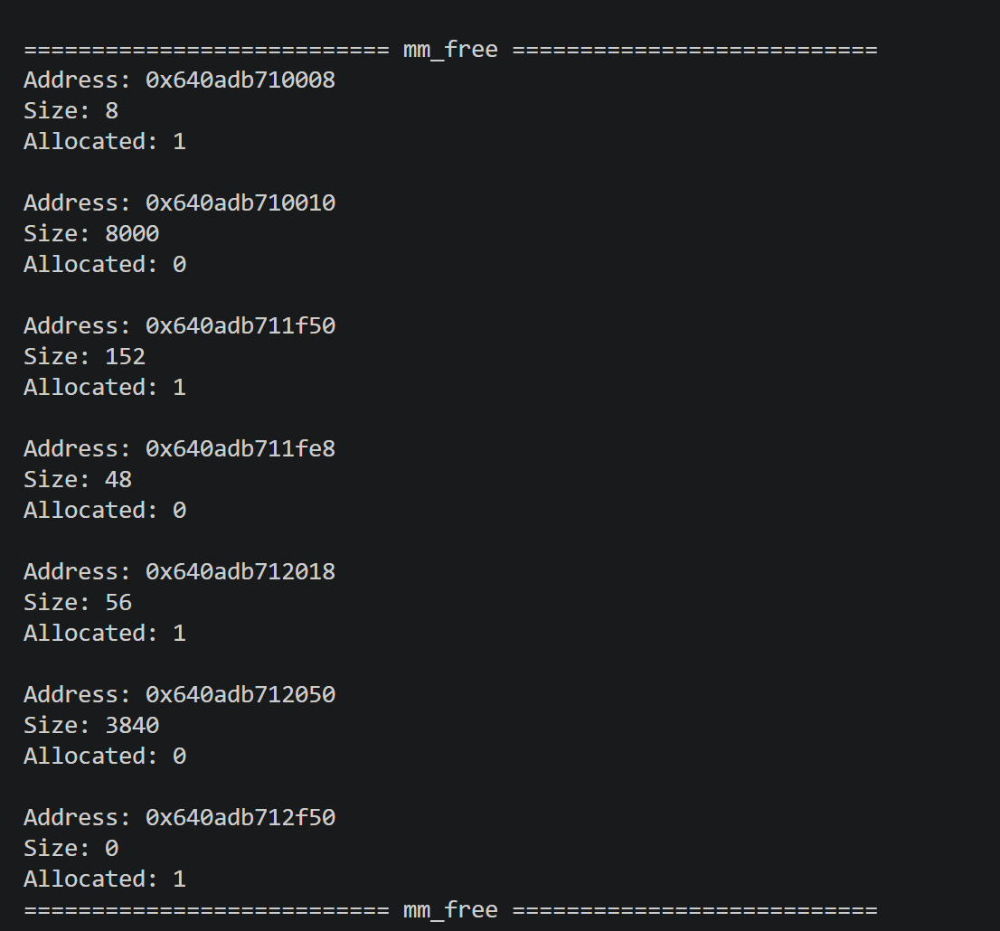
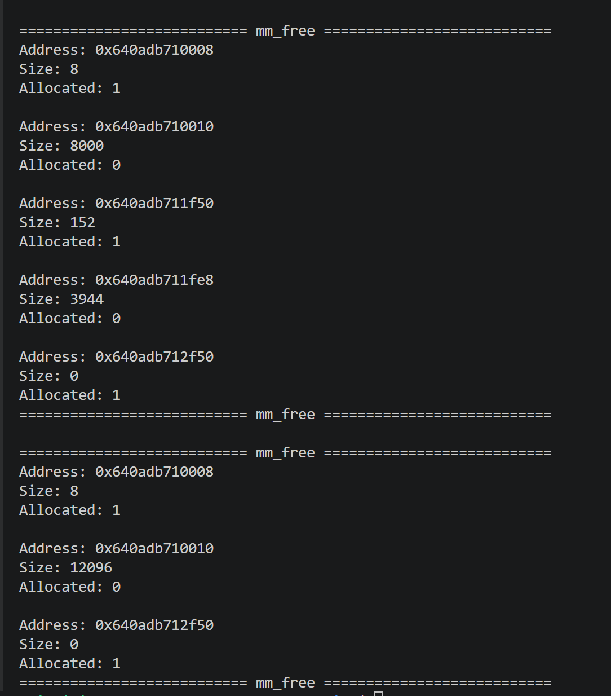
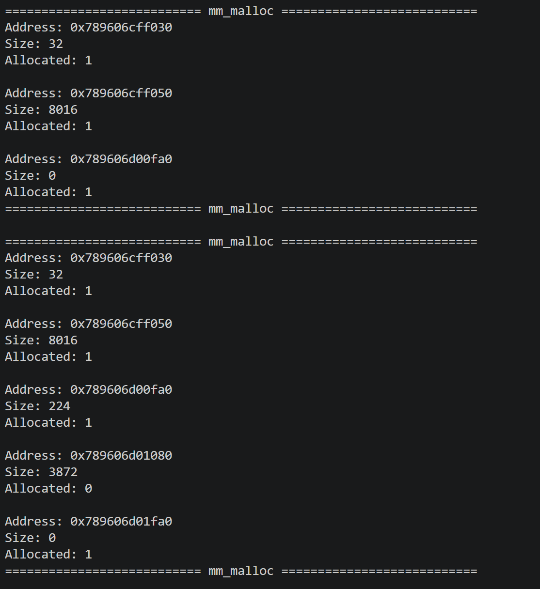
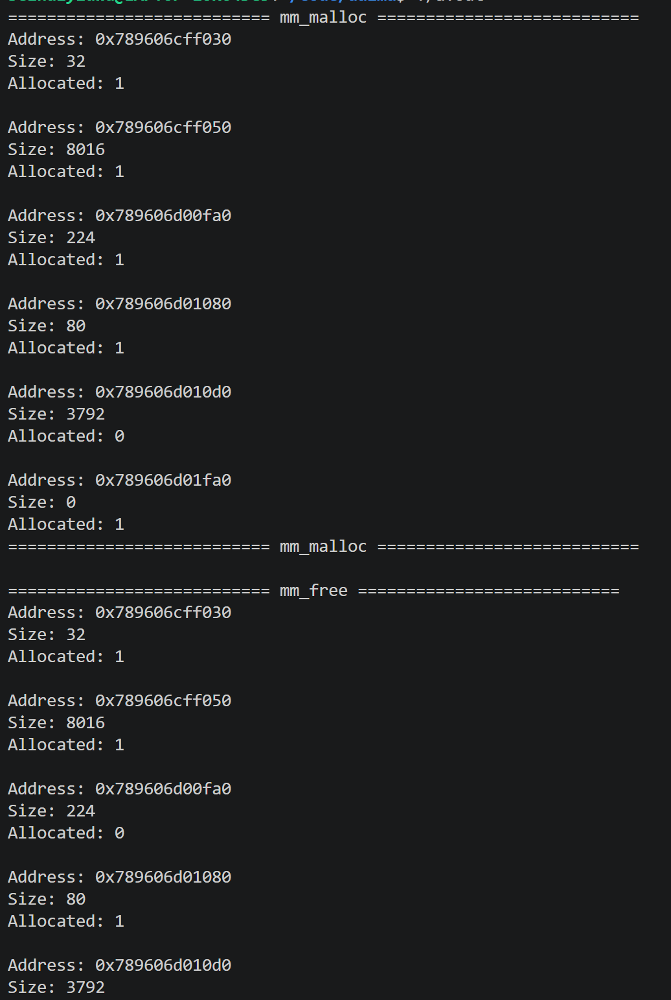
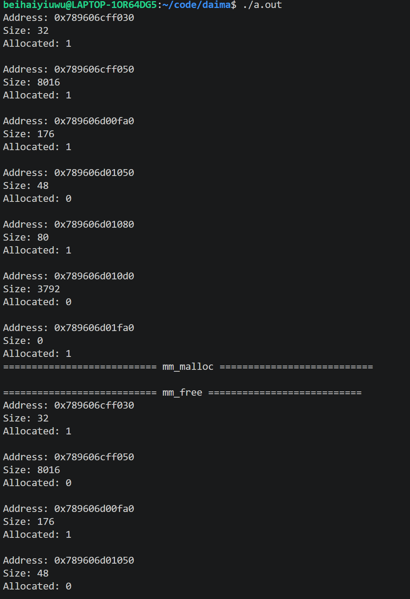
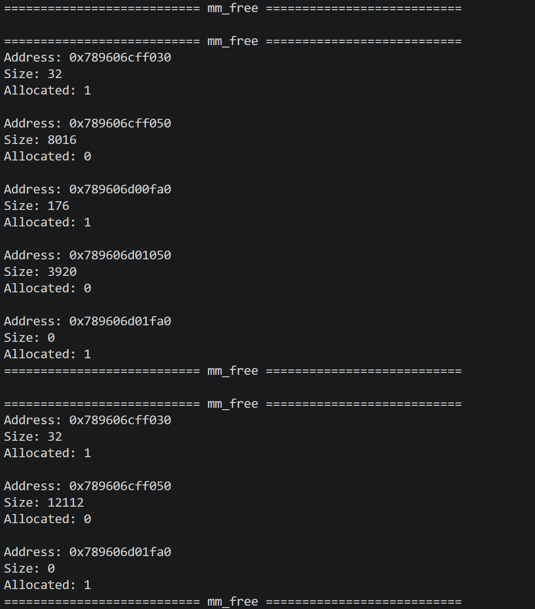

# 前置知识
1. 什么是堆？
* 堆就是虚拟内存中一块很大的空间，自己手动申请和释放，生命周期在于申请和释放之间。堆是自下而上，从低地址到高地址，与栈相反。栈的空间较小，同时生命周期在函数结束时就消失了，而堆就是来解决这个问题。
2. 什么是动态内存分配器？什么是空闲块？什么是对齐？什么是碎片？
* 动态内存分配器是管理堆内存的“大管家”，调用堆时底层就是分配器在干活。当使用malloc申请时，它在堆上给了你一块内存，返回首地址，free时再回收。
* 堆内存被分配器切分成了一个个的块，空闲块是已经free回了，或者从来没有申被分配过，随时可以再次分配给程序的内存块。还有一个是已分配块，malloc了还没free的内存，里面存着相关的数据。
* 对齐，指分配器返回的内存地址，必须是某个特定数值的倍数（通常是8字节或16字节的倍数），这与结构体的内存对齐原则类似，主要是为了方便一整块的读取数据，否则读完了还有凭借，浪费时间，
* 碎片指的是存储空间被分割成很多小块，空间浪费没法高效利用，这些小块就叫碎片，分为外部碎片和内部碎片。内部碎片是你申请的内存比你实际要用的多，多出来的浪费在“块”内部，这部分就叫内部碎片。外部碎片是堆里总共有足够的空闲空间，但这些空闲空间不连续，被切碎了，导致大块内存申请失败，这些小块部分就叫外部碎片。
3. 为什么分隐式和显式？它们分别是什么？
* 是为了区分分配器是如何知道每个内存块的大小的。主要分为隐式空闲链表和显示空闲链表。隐式空闲链表，分配器没有专门建一个空闲块名单，每次都只能从头部往后看这个块的大小和是否分配。显示空闲链表，分配器设有一个空闲块名单串联成一个链表，只不过这个链表有两个指针，一个指向前，一个指向后，所以是双向的。分配器要申请或释放内存时只需要看这个表就行了，相对于隐式要方便许多。
4. 什么是吞吐量？什么是空间利用率？
* 吞吐量：衡量速度。单位时间内能干多少活，即每秒能成功完成多少次malloc和free操作，计算公式是完成的内存分配和释放请求总数除以总耗时。
* 空间利用率：衡量省不省地方。占用的空间里有多少是真正有用的，计算公式实际内存除以分配的内存，浪费的内存多半是被对齐规则浪费掉了。
# 实验0
1. 为什么不能free新增长的空间？
* 因为free不知道要释放多大的内存，怎么将其标记为空闲。
# 实验1
* 元信息是记录数据的数据，每个块都会有元信息，称为header，包含这个块的大小，分配状态，还有两个指向上下空闲块的指针。分配块的内存时还要留一部分内存给这些元信息储存这些内容，这样free时就知道大小和如何标记了。就像是一页作业，除了记录作业内容，还要包含你的姓名学号日期章节等，内容就是储存的数据，而名字这些就是元信息。
1. 为什么我们要用链表来存储内存块地址？为什么不能用数组？
* 每一个块的首尾都包含了该块的元信息，是为了实现双向的功能，而非单向。但要free一个块时，我们要知道前后块的相关信息来确定怎么标记，这时候就需要头和尾两个元信息了。指针向前得到前一个的元信息，向后得到后一个的元信息，如果都是空闲块便可以直接合并，减少碎片，而用数组显然不够方便合并，链表相对于数组的优势就在于便于实现相关块的合并与增删。
2. ftr的作用是什么？
* 尾部的元信息，后一个块想知道前一个块的相关信息就靠这个尾部的元信息。
### 1
1. 为什么使用宏定义
* 减少运算时间。如果用函数还要重新分配栈，宏定义只是实现文本替换，减少时间消耗。
* 代码更加易懂，讲相关计算封装，形成易于看懂的伪代码。
* 绕过类型系统，直接对内存地址进行位运算。因为在宏中已经进行了强制转换，如果用函数会更加麻烦。
2. 为什么要把size和alloc打包？（从位操作的角度想）
* 将size和allocated bit合并为一个字，这是为了节省内存空间。不管多少字节，永远是8的倍数，这样最后3位一定是0，我们把最后一位0看作分配的标志，这样就不需要1字节额外表示分配状态了，节省了很多内存。打包在一起便即能表示大小又能表示占用情况。
3. 为什么可以得到上一个块的地址？对齐的作用是什么？
* 计算的宏定义为((char*)(bp) - GET_SIZE((char*)(bp) - DSIZE))，bp减去DSIZE恰好是上一块的尾部，读取这个尾部便能知道上一个块的大小，再用当前块减去上一个块的大小恰好是上一个块的指针，得到地址。
* 对齐是为了方便硬件读取。硬件不是一字节一字节的读，而是一块（如8字节）的读。如果不对齐读完还用拼接浪费大量时间，直接对齐的化就不要拼接浪费时间了。浪费几个字节换来运行速度的提升。
4. 这个实验中怎么处理内部碎片？合并和分割空闲块会产生多余的hdr和ftr吗？
* 直接将内部碎片变为空闲块。会产生多余的，合并时原先存在的hdr和ftr直接被覆盖了，只不过还保留在原先的地方形成载荷，切割会将新的空闲块进行标记，于是产生了多余的hdr和ftr。
5. 隐式分配器的时间复杂度是多少？为什么要遍历整个链表？怎么提升性能？
* 是O（n），n代表块的个数。这是隐式空闲链表，是通过往后增加内存来创建新的块的，并没有一个指针来指向它，所以必须从头进行遍历，可以用数组的方式理解，从下往上使用sbrk把空间堆起来，空闲块和已分配块连在一起，只能从头读header来判断它是空闲块还是已分配块以及大小。可以使用分离链表的操作，链表A管16字节大小的，链表B管24字节大小的，需要多少就去那个链表找，或者直接就用显示空闲链表，把空闲块弄在一个链表中。
6. 只有在被分配的块被free时才进行一次合并。请你思考：为什么不在每次搜索不到足够大的空闲块时进行一次遍历合并？相对可行的合并方法是什么？
* 可以进行遍历合并，已减少多余内存的消耗，但遍历一次耗费的时间也会增加，时间换空间。每次找空闲块进行遍历的时候可以顺便合并一下，遍历完一次对应的空闲块就被合并了。
7. 运行截图

8. 反思：通过在堆上堆空间实现堆的增长，也导致了遍历只能从头遍历，通过地址增加实现往下一个块的遍历。整个代码最坑的地方是合并那个函数的第4种情况，两边都为未分配的时候，算尾那个元信息必须用next的，因为header的size还是原来的。我调试打印的时候发现总是合并不到一起，于是翻阅深度理解计算机系统进行查阅，并搜索相关资料，改正了这个错误。
# 实验2 
1. 运行调试结果截图

* 个人反思与总结：整体感觉显式的难度远远大于隐式，主要是在于分配块和空闲块的结构发生了很大的变化，分配块没有后面的元信息了，又多出来一位存前面的分配情况，而这些都是新加的。相比较与隐式，最大的区别应该就是加了了空闲链表，这个链表是嵌在这个堆上的，物理内存没有，逻辑内存变了（空闲块而言），所以遍历的时候很方便，只需要后继一下就行，大大增加了运行速率，但也增加了内存。最难写的我觉得是place函数，切割这个部分。整体思路大致是先判断大小够不够，够的话根据find函数找到的空闲块进行分配。首先需要把这个空闲块从空闲链表中取出来，然后进行切割，在这里有两个部分：首先将该块设为已标记，再将切下来的剩余空闲块设置为未标记，同时pre_ALLOC也要更新，还要改后面那个块的状态，最后还要把这个部分add回空闲链表。个人觉得相对于隐式最大的区别函数就在这里。合并函数和隐式写法大致相同，增加和删除函数分别用头插和连接就可以，与普通链表原理相同。
* 个人写完代码调试总是报错段错误，通过断点调试每一个函数我可以定位到哪个函数出了问题并进行修改。但修正place函数我遇到了较大的阻碍，因为不管我怎么改内存分配情况都不对，为此我求助了一下AI，让AI帮我检查这一部分哪里出现了问题，发现最终是在标记上标记出了很大问题，导致合并时不对劲。还有一个地方是delete函数我没有判断结尾的情况，导致出现了段错误，通过加上这种情况也是最终解决了这个问题，由此可见在内存操作中边界是十分重要的，必须设置和判断好边界的情况，不然越界访问是很危险的。
# 后记
* 要调试分配器性能要使用专门的压力测试驱动程序，如mdriver。在显示空闲链表中写了find—fit—best函数但并未使用，如果用它的话可以找到最适合的空闲块，减少内部碎片的产生，提高空间利用率。显然显示空闲链表的吞吐量大于隐式的，遍历效率更高，无需一个一个遍历。所以多使用显示空闲链表，还有一种是分离空闲链表，将大小相同的空闲块分别连在一个链表上，要用多大就去那里找，速度更块，但占用内存更多。各种链表只能说各有优缺。